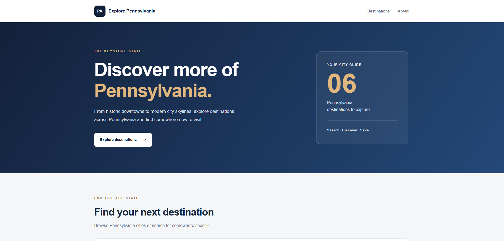
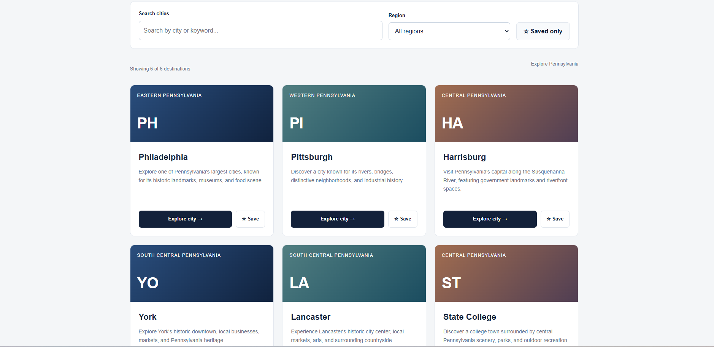

# Pennsylvania State Guide — Explore Pennsylvania

**HTML5 | CSS3 | JavaScript | Responsive Web Design**

Explore Pennsylvania is an interactive website I built using HTML, CSS, and JavaScript. It allows users to explore different cities across Pennsylvania, search for destinations, filter by region, and save places they're interested in visiting.

The application currently features six Pennsylvania destinations, including Philadelphia, Pittsburgh, Harrisburg, York, Lancaster, and State College.

## Application Screenshots

### Homepage

### Destinations

## Problem

Finding places to visit across Pennsylvania can involve searching for different cities individually.

I wanted to build a website that brings information about several Pennsylvania destinations together and gives users a simple way to explore them.

## Solution

I developed a responsive website using HTML, CSS, and JavaScript without relying on a frontend framework.

Users can browse city cards, search for destinations by name or keyword, filter cities by region, and open additional information about each location.

I also implemented a feature that allows users to save destinations using browser local storage, so their selections remain available after refreshing the page.

## Features

- **City Exploration:** Browse six Pennsylvania destinations with descriptions and local highlights.
- **City Search:** Search destinations by name or related keywords.
- **Regional Filtering:** Filter destinations by geographic region.
- **Destination Details:** Open a dialog displaying city information and notable attractions.
- **Saved Destinations:** Save or remove cities from a personal list.
- **Local Storage:** Preserve saved destinations between browser sessions.
- **Responsive Design:** Adapt the website layout to desktop and smaller screens.
- **Empty State Handling:** Display a message when no destinations match the selected filters.

## Technologies Used

| Technology | Purpose |
|---|---|
| HTML5 | Website structure and semantic elements |
| CSS3 | Styling, layout, and responsive design |
| JavaScript | Search, filtering, and interactive functionality |
| Local Storage API | Saving destinations in the browser |
| HTML Dialog API | Displaying destination details |
| Node.js | Running automated tests |
| jsdom | Simulating browser interactions during testing |
| Git & GitHub | Version control and project documentation |

## How It Works

1. The website loads information about six Pennsylvania destinations from a JavaScript data collection.
2. JavaScript creates and displays the destination cards dynamically.
3. Users can search destinations or filter them by region.
4. Selecting "Explore city" opens a dialog containing additional information and local highlights.
5. Users can save destinations, which are stored in the browser using local storage.
6. The saved destinations can be displayed separately using the "Saved only" filter.

## Getting Started

This project uses HTML, CSS, and JavaScript and does not require a frontend framework or build process.

**1. Clone the repository**

`git clone https://github.com/sancruz68/pennsylvania-state-guide.git`

**2. Open the project directory**

`cd pennsylvania-state-guide`

**3. Run the website**

Open `index.html` in a web browser.

No additional packages are required to view the website.

**4. Install dependencies for testing**

`npm install`

**5. Run automated tests**

`npm test`

## Testing

I manually tested the website's interactive features and added automated tests using Node.js's built-in test runner and jsdom.

### Automated Tests

All seven automated tests passed:

- Displaying all six destinations.
- Searching cities by name.
- Filtering destinations by region.
- Displaying an empty state for invalid searches.
- Saving destinations to local storage.
- Restoring saved destinations from local storage.
- Opening and closing city details.

### Manual Testing

I also verified:

- Searching for York and displaying the matching destination.
- Filtering Western Pennsylvania destinations.
- Opening and closing the York details dialog.
- Saving destinations and using the "Saved only" filter.
- Preserving saved destinations after refreshing the page.
- Displaying the website correctly at smaller browser widths.

## Current Limitations

- The website currently includes six Pennsylvania destinations.
- Destination information is maintained locally in JavaScript rather than retrieved from an external API.
- Saved destinations are specific to the user's browser and are not synchronized across devices.

## Future Improvements

- Expand the number of cities and attractions.
- Add properly licensed destination photography.
- Improve filtering and accessibility.
- Introduce additional destination information.
- Deploy the website for public access.

## What I Learned

This project gave me more experience building a website using HTML, CSS, and JavaScript without relying on a framework.

I worked on dynamically generating content, handling user interactions, filtering data, saving information with local storage, and creating responsive layouts.

I also gained more practice writing automated tests and verifying that different website features work correctly.